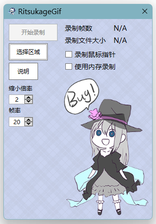
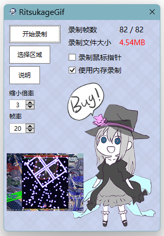
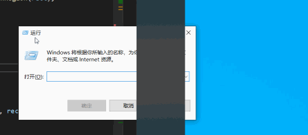

# RitsukageGif

Screen capture, recording, and image editing.

The executable is `RitsukageGif.exe`.

## Configuration

Settings, logs, and pinned-image history are stored in `%LOCALAPPDATA%\RitsukageGif` on Windows. Import and export settings from the dedicated page in Settings.

Changes in the main Settings window take effect immediately and are saved automatically about three seconds after the last change. Closing Settings saves pending changes. The administrator preference takes effect when starting a new process. Dedicated editors still use Save and Cancel.

Settings is non-modal, so global actions remain available while it is open. Global shortcuts pause while a shortcut input has keyboard focus. Editing an unrelated setting preserves changes made from the capture and pinned-image tools.

Set `RITSUKAGE_DATA_DIRECTORY` to an absolute directory before starting the application to use a separate data directory. This directory does not automatically import settings from an older installation.

Run `RitsukageGif.exe --version` to print the build version without opening a window or accessing configuration files.

## Preview

#### Main window  

#### Main window with image capture  

#### Captured Gif images  

#### Dpi Awareness  
  
In the testing environment of this image, the left monitor is set to 125% dpi, and the right monitor is set to 150% dpi
