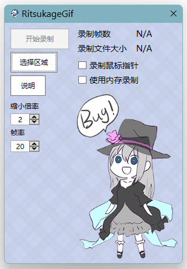

# RitsukageGif

用于屏幕录制、截图标注和动图编辑。

启动程序后，选择录制区域，再开始录制；帧率、缩小倍率和输出格式可在主界面调整。截图可从托盘菜单或功能动作启动。

预设用于保存捕获范围、布局和输出规则。从主界面的“预设”菜单打开编辑器，可编写、运行和调试脚本。

- [使用手册](docs/README.md)
- [编辑器与命令行](docs/editor-and-cli.md)
- [API 参考](docs/api-reference.md)与[类型参考](docs/script-types-reference.md)
- [完整命令行参考](docs/cli-reference.md)
- [可运行范例](examples/README.md)

## 效果预览

